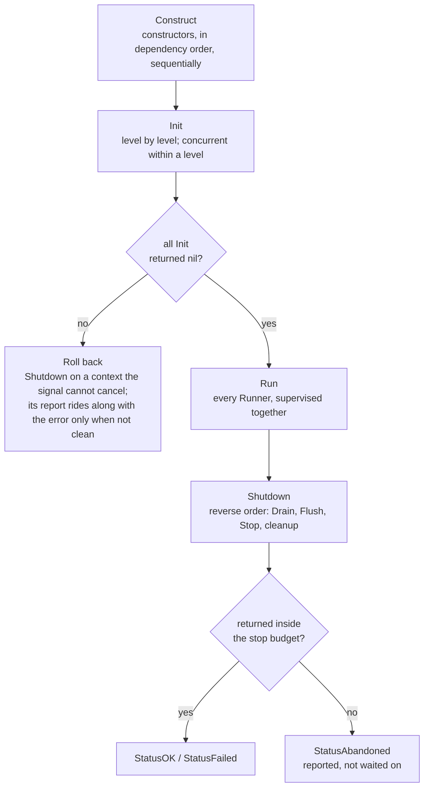

# Lifecycle

**Who this is for:** anyone implementing a component that needs to start, stop, or report its
health — and anyone debugging a startup failure or a shutdown that didn't come out clean.

The whole contract is seven method signatures. A component opts into the lifecycle by **having a
method**, not by registering for one: detection is structural, checked with `types.Implements` at
generation time, and no component ever imports `servo` to participate.

## The seven capabilities

```go
type Initializer interface{ Init(ctx context.Context) error }
type Runner      interface{ Run(ctx context.Context) error }
type Drainer     interface{ Drain(ctx context.Context) error }
type Flusher     interface{ Flush(ctx context.Context) error }
type Finalizer   interface{ Stop(ctx context.Context) error }
type Healther    interface{ Health(ctx context.Context) error }
type Readier     interface{ Ready(ctx context.Context) error }
```

| Capability | Method | Called during | Order | Under a budget |
| --- | --- | --- | --- | --- |
| `Initializer` | `Init` | `New` | Level by level, ascending; concurrent within a level | Only when `servo.DefaultInitBudget` is set |
| `Runner` | `Run` | `Run` | All at once, supervised together | No; a grace period once `Run`'s context ends |
| `Drainer` | `Drain` | `Shutdown` | Reverse dependency order; first of the three | Yes |
| `Flusher` | `Flush` | `Shutdown` | After `Drain`, same node | Yes |
| `Finalizer` | `Stop` | `Shutdown` | After `Flush`, same node | Yes |
| `Healther` | `Health` | `Health`, when you call it | Construction order | No |
| `Readier` | `Ready` | `Ready`, when you call it | Construction order | No |

Implement none of them and your component is simply constructed and held — no lifecycle code is
emitted for it at all. Implement three and exactly those three are called. There is no base type to
embed, no no-op method to write, and nothing to register.

This page describes the lifecycle of a **singleton** — one instance, built in `New`, stopped in
`Shutdown`. A [scoped](scopes.md) component runs the same seven methods on the same machinery, but
per instance and on its own schedule; see
[Per-instance lifecycle](scopes.md#per-instance-lifecycle) for the two places the two differ.

The third case is an emitted [HTTP server](http.md) — machinery, not a graph node, so it implements
no capability and appears in no level. It is folded into the same three calls at fixed points:
constructed after every node and **before** the Init phase (fallibly — a declared group missing
from `HTTPConfig.Groups` fails `New` with the usual rollback, before anything expensive has
started), run alongside the runners in `Run`, drained **first** in `Shutdown`,
and reported per group by `Ready`.

`servo explain <type>` prints the capabilities detected for any node, and the generated file's
header comment lists them for the whole graph, so what servo saw is never a mystery.

## The phases



`New` covers Construct and Init. `Run` and `Shutdown` are separate calls your `main` makes — or
that [`servo.Main`](#your-main) makes for it. Nothing here is a framework callback — it is all
plain code in a file you can open and step through.

## Construct

Constructors are called sequentially, in dependency order. Every dependency is fully constructed
before anything that needs it, and each node is constructed exactly once no matter how many
consumers it has. Any [supplied value](spec.md#value) is copied out of `Values` first, ahead of
every constructor, since something has to be able to depend on it.

**If a constructor returns an error**, `New` stops there, undoes what it already built, and returns
that error. The rollback calls the stop path of every node constructed before the failure, in
reverse order — and only those, because the ones after it don't exist yet. That's why the rollback
is a literal, unrolled sequence of calls in the generated source rather than a runtime loop over a
"what succeeded so far" list: the compiler already knows.

Rollback results are discarded. The error you get back is the constructor's own, undiluted, because
the app was never fully assembled and a report about a half-built graph would be noise.

Construction is never concurrent, even for independent nodes. Calling a constructor is cheap —
almost always struct assignment — and a sequential `New` is one readable straight line, which is
worth more than microseconds.

## Init

`Init` is for the expensive part: opening a connection, running a migration, warming a cache.
Anything that can fail slowly belongs here rather than in a constructor, because this is the phase
built to handle failure.

Calls are grouped by [level](resolution.md#construction-order-and-levels). Levels run in ascending
order, so a component's dependencies are always initialised before it is, and the calls within a
level run concurrently. The whole phase is one call into the runtime, the same for a level of one
as for a level of ten:

```go
if err := servoimpl.Init(ctx, servo.DefaultInitBudget, &a.startupReport,
	[]servoimpl.Call{
		{Node: "*postgres.DB", Fn: a.db.Init},
		{Node: "*redis.Cache", Fn: a.cache.Init},
	},
	[]servoimpl.Call{
		{Node: "*api.Server", Fn: a.server.Init},
	},
); err != nil {
	return nil, servoimpl.RolledBack(err, a.Shutdown(context.WithoutCancel(ctx)))
}
```

**`Init`'s context is for the `Init` call.** Each call gets a context of its own, derived from
`New`'s — values arrive, a deadline carries over — and cancelled the moment that call returns. It
is cancelled earlier if another `Init` at the same level fails, if `New`'s own context is
cancelled, or if [`servo.DefaultInitBudget`](servo-package.md#defaultinitbudget-and-defaultrungrace)
runs out. Work that should outlive startup — a refresher, a watcher, a consumer loop — belongs in
`Run`, not in a goroutine `Init` starts on its context: that goroutine sees `ctx.Done()` as soon as
`Init` returns. Before v3.5.0 the rule depended on the level: a node alone at its level was handed
`New`'s long-lived context, while a level of several shared an errgroup's, which dies when the level
finishes — so a refresher started in `Init` survived, until an unrelated `Initializer` happened to
land on the same level and it died right after `New`.

**A panic in `Init` is that node's failure.** It is recovered, turned into an error carrying the
panic value and the stack it was raised on, and handled exactly like a returned error, rollback
included. It used to be uneven: a panic on a level of one unwound through `New` into `main`, and one
on a shared level killed the process from a goroutine nothing could recover — and in neither case
did the rollback run.

**Every failure names its node.** It is a [`*servo.NodeError`](servo-package.md#nodeerror) with
`Phase` `"Init"`, rendering as `*postgres.DB: Init: dial tcp 127.0.0.1:5432: connect: connection
refused`; `errors.Is` and `errors.As` see through it to the component's own error. The first
failure cancels the other calls at its level, and an error a sibling returns only because of that
cancellation is not reported as a second failure. Two genuine failures at one level are both
reported, joined. A level that fails is the last one to run.

**The budget.** `servo.DefaultInitBudget` is zero, meaning none, so by default `New` waits for every
`Init` it started — including one that ignores its context. Set it, before `New`, and it becomes
the deadline of every `Init`'s context and the limit on waiting for it: an `Init` that respects its
context returns at the deadline and fails naming the budget, and one that ignores it is abandoned
at the same moment — reported, and left running — so a dependency that accepts a connection and
never answers can no longer hold `New` open with no output at all. The same budget applies to every
[scoped](scopes.md#per-instance-lifecycle) `Init`.

**If `New`'s context ends during the phase, `New` fails.** The signal arriving mid-startup — a
rolling deploy, a pre-empted crash loop — cancels it; `New` starts no further level, waits for the
calls already running, rolls back, and returns an error wrapping `context.Cause(ctx)`:
`servo: startup interrupted: interrupt signal received`, for which `errors.Is(err,
context.Canceled)` holds. It does this even when every `Init` that ran succeeded. It used to return
a working application to a caller that had already been told to stop, and `Run` then bound its
ports.

Each call is timed, and the durations are what `App.Report()` returns — per-node startup cost with
no external instrumentation. Within a concurrent level the report is in *completion* order, not a
declared order, so don't assert an exact sequence for nodes that share a level.

**If the phase fails**, `New` calls the app's own `Shutdown` — safe here, unlike during
construction, because every node exists by now — and returns what `servoimpl.RolledBack` makes of
the failure and the unwind's report:

- **A clean unwind returns the failure itself.** `Report` satisfies `error` by value, so joining a
  clean one appended its empty `Error()` as a blank line to every ordinary startup failure, and that
  trailing newline survived into any log field or `%w` wrapping built from it.
- **An unclean one rides along without joining the chain.** The message ends with it —
  `*redis.Cache: Init: connection refused`, then `rollback: *postgres.DB: abandoned: context
  deadline exceeded` on a line of its own — and `errors.As` retrieves it:

  ```go
  var rollback servo.Report
  if errors.As(err, &rollback) {
  	// what the unwind could not stop cleanly
  }
  ```

  But `errors.Is` does not descend into it. It used to be joined, so a rollback `Stop` that overran
  its budget made `errors.Is(err, context.DeadlineExceeded)` true for a startup that had failed for
  an unrelated reason — and the only node the message named was that innocent one.

Either way `New` returns a nil `*App`: there is no partially initialised app to inspect.

## Stopping what was never initialised

**`Drain`, `Flush` and `Stop` can be called on a component whose `Init` never ran.** This is the
contract most easily missed, and the one that turns an ordinary startup failure into a panic during
the unwind.

Both rollback paths reach nodes that were only ever constructed:

- **A constructor failure** stops every node built *before* it. None of them has been `Init`ed at
  all — the `Init` phase has not started.
- **An `Init` failure** calls the app's own `Shutdown`, which walks the **whole** graph. That
  includes the node that just failed, and every node at a level *above* the failure, whose `Init`
  was never reached. `Shutdown` cannot be narrowed to "the ones that succeeded" without the runtime
  bookkeeping the generated code deliberately doesn't carry.

So a teardown method must tolerate the state its constructor left, not the state `Init` would have
produced:

```go
// Wrong. Reached during rollback with pool still nil, and the panic
// happens inside RunStop's goroutine, mid-unwind.
func (d *DB) Stop(ctx context.Context) error { return d.pool.Close() }

// Right.
func (d *DB) Stop(ctx context.Context) error {
	if d.pool == nil {
		return nil
	}
	return d.pool.Close()
}
```

The general rule: whatever `Init` acquires, the matching teardown has to check for. A nil pool, a
nil client, a zero-value channel — a constructor that leaves them unset is ordinary Go, and the
rollback is exactly the path that exercises it. [`RunStop` recovers the
panic](#the-stop-budget) if you get this wrong, so the process survives and the node is reported as
failed, but the real startup error then arrives with a stack trace stapled to it.

**Both rollback paths run on `context.WithoutCancel(ctx)`.** They used to pass `New`'s own `ctx`
straight down, and every `main` in this documentation hands `New` a context the shutdown signal
cancels — [`servo.Main`](#your-main) does. A SIGTERM arriving mid-startup — a rolling deploy, a pre-empted crash-loop restart —
therefore cancelled it, aborted an `Init`, and then the unwind was handed a context that was already
done. `RunStop` derives its budget from it, so `Done` was closed before the `select` ran and
every node was reported abandoned without its `Drain`, `Flush` or `Stop` getting a chance to do
anything: the real startup error buried under a wall of `abandoned: context canceled`.

Stripping the cancellation is the same rule this page states for `main`'s
[`Shutdown`](#the-shutdown-deadline), and the one [scoped teardown](scopes.md) already followed. Nothing can hang as a
result — `RunStop` still caps every phase at its own budget.

## Run

```go
func (a *App) Run(ctx context.Context) error
```

Launches every `Runner` and supervises them together, through one call into the runtime:

```go
return servoimpl.Run(ctx, servo.DefaultRunGrace,
	servoimpl.Call{Node: "*api.Server", Fn: a.server.Run},
	servoimpl.Call{Node: "*worker.Consumer", Fn: a.consumer.Run},
)
```

With no runners at all, `Run` returns `nil` immediately. Otherwise each runner gets a goroutine of
its own and a shared context derived from `ctx`, and:

- **A runner that fails cancels the rest.** Failing means returning an error that is not merely the
  context's own end, or panicking. A runner that returns `nil` cancels nothing — a finite job can
  finish beside a server meant to run until the signal.
- **A panic is a failure, not a crash.** It is recovered into an error carrying the panic value and
  the stack, the other runners are cancelled, and `Run` returns it — so `main`'s `Shutdown` runs, and
  whatever a `Flusher` was holding gets flushed. The runner's goroutine is servo's, not yours, so no
  `recover` you could write would reach it: before v3.5.0 the panic ended the process on the spot,
  with nothing drained, flushed or stopped. A lone runner gets the same treatment; it used to be
  called directly, with no `recover` at all.
- **The wait is bounded once the context ends.** From the moment `Run`'s context is done — the
  shutdown signal, or a runner failing — each runner still running has
  [`servo.DefaultRunGrace`](servo-package.md#defaultinitbudget-and-defaultrungrace) (5 seconds by
  default) to return. Past it `Run` stops waiting, leaves it running, and returns an error naming
  it, so `Shutdown` can begin. `Run` used to wait without limit, and a runner that ignored its
  context kept the whole process — listeners still serving — up until the supervisor killed it.

**What `Run` returns**, in order of preference: every failure, each a
[`*servo.NodeError`](servo-package.md#nodeerror) with `Phase` `"Run"` — `*worker.Consumer: Run:
broker unreachable`, a panic or a runner left running included — joined when there are several;
otherwise the first error a runner returned because the context ended, unchanged, which is what an
ordinary shutdown has always returned (usually `context.Canceled`); otherwise `nil`. A failure is
never masked by a sibling that merely returned its cancellation first: the errgroup this replaced
returned whichever error came first, so a runner whose final flush failed after the signal was
hidden behind a server's `context.Canceled`.

Emitted HTTP servers count here too: each group's server is supervised alongside the runners —
named `"http"` or `"http:<group>"` in an error — binds its listener, flips its readiness flag and
serves until the context ends; so "none" means no runners *and* no servers, and a failing runner
takes the listeners down with it.

`Run` blocks for as long as the application is running. It does **not** call `Shutdown` — that's
your `main`'s job, so that the same code path handles both "a runner failed" and "we got a signal".
[`servo.Main`](#your-main) does both, and is the documented `main`:

```go
func main() { servo.Main(New) }
```

## Shutdown

```go
func (a *App) Shutdown(ctx context.Context) servo.Report
```

Stops every node with something to stop, in **reverse dependency order** — so a server stops
before the database it queries. Emitted HTTP servers stop before any of it: they are the inbound
edges, and draining them is what lets everything beneath quiesce. For each node, in this order:

1. `Drain(ctx)` — stop accepting new work and let in-flight work finish
2. `Flush(ctx)` — push buffered state somewhere durable
3. `Stop(ctx)` — release the resource
4. the constructor's cleanup `func()`, if it returned a non-nil one

Only the phases that node actually implements are emitted. **Each phase gets its own budget**, so a
node implementing all three can take up to three budgets in the worst case.

There is deliberately no separate "quiesce" phase. Waiting for in-flight work is `Drain`'s job,
inside your own component, where the knowledge of what counts as in-flight actually lives.

**Every node's stop path is idempotent**, guarded by a `sync.Once`, because the same path is
reachable from both construction rollback and `Shutdown`. Calling `Shutdown` twice returns the same
results without touching your components again. It is also why these methods have to tolerate a
node that was never `Init`ed: see [Stopping what was never
initialised](#stopping-what-was-never-initialised).

`Shutdown` never returns an error — it returns a [`servo.Report`](servo-package.md#report), which
is a per-node account of what happened. It also satisfies `error`, so it composes with
`errors.Join` and `%w`. Check `r.Clean()` for the one-line answer.

**A second signal during shutdown forces an immediate exit.** `Shutdown` installs its own
`os.Interrupt`/`SIGTERM` handler for the duration of the call, and if one arrives it writes one line
to stderr and exits the way a shell reports a process a signal killed — 128 plus the signal's
number, so 130 for SIGINT and 143 for SIGTERM:

```
servo: interrupt signal received during shutdown, exiting with status 130 without finishing it
```

It used to be a silent `os.Exit(1)`: nothing in the log said the unwind had been cut short, and
nothing in the status told an operator's own interrupt apart from an ordinary failure. The *first*
signal is your `main`'s to handle. [`servo.Main`](#signals) handles it, and also a second signal
that arrives before `Shutdown` begins, in the same words; this watcher is the second-signal half
for the duration of the call, and it lives in generated code so a hand-written `main` gets it too.

## The stop budget

```go
var servo.DefaultStopBudget = 5 * time.Second
```

Every phase call during shutdown and rollback runs under this budget, through `RunStop` —
`servoimpl.RunStop` in files generated since v3.5.0, [`servo.RunStop`](servo-package.md#runstop)
in older ones: the call is made in its own goroutine, and if it hasn't returned when the budget
expires the node is reported **abandoned** rather than waited on. The budget is also capped by
whatever deadline the context `Shutdown` was given carries, so the unwind as a whole cannot outlast
it.

The same budget bounds every per-instance call inside a scope's teardown, so one component that
refuses to stop cannot hold a whole scope's eviction open.

| Outcome | Status | Meaning |
| --- | --- | --- |
| Returned `nil` in time | `StatusOK` | Stopped cleanly |
| Returned an error in time | `StatusFailed` | Tried to stop and failed; the error is on the result |
| Panicked | `StatusFailed` | The panic is recovered; the value and the stack become the error |
| Didn't return in time | `StatusAbandoned` | The context deadline is the error; the goroutine is left running |
| Context already done | `StatusAbandoned` | Not attempted: the call is never made, and the error says so, wrapping the context's own |

Abandoned means exactly what it says: the process moves on and the goroutine may still be alive.
Servo takes the position that reporting an abandoned node honestly beats hanging forever, and it
never claims a clean stop it didn't earn.

**Once the shutdown deadline has passed, nothing more is started.** Every node still to come is
reported abandoned, `not attempted`, without its `Drain`, `Flush` or `Stop` being called. Before
v3.5.0 each was started anyway and abandoned the same instant, which meant that once the deadline
went by, every remaining stop began at once, in the background, concurrently and out of the order
the graph requires, while `main` exited around them — a database closed under a producer that was
still flushing into it. A node that gets no turn is the honest outcome of a deadline that ran out;
one that gets a turn out of order is a second failure on top of it.

**A panic in a stop phase is recovered and reported, not propagated.** The phase call runs in
servo's goroutine, not yours, so no `recover` in your `main` could ever reach it: unrecovered, one
panicking `Stop` kills the process mid-teardown, leaving every node behind it running and no
`Report` to say which. `RunStop` turns it into one `StatusFailed` node carrying the panic
value and the stack, and the rest of the unwind continues. This is what keeps a `Stop` that assumes
`Init` ran — see [Stopping what was never initialised](#stopping-what-was-never-initialised) — from
taking the process down during a rollback.

Per-node results are merged with **abandoned outranking failed outranking OK**, and every phase's
error joined, so one node with a clean `Drain` and a timed-out `Stop` is reported once, as
abandoned.

It is a package variable rather than configuration because parsing configuration is out of scope
for a code generator. Set it before `New` if 5 seconds is wrong for your service; in tests, use
[`servotest.Timeout`](servotest-package.md#timeout), which shrinks it and restores it via
`t.Cleanup`.

### Scopes in the shutdown sequence

An app with [scopes](scopes.md) gets one extra step per scope, sequenced into the same
reverse-dependency order: after every singleton that could still call `Acquire` on it, and before
every singleton its instances depend on. Each scope reports **one `NodeResult`**, merged from every
entry it tore down — one line per live chat room would not be a report.

### HTTP servers in the shutdown sequence

An app that declares [`servo.HTTP()`](http.md) stops its emitted servers **first**, before every
singleton — the mirror image of them being constructed last — and every group at once. Each
reports one `NodeResult`, named `"http"` or `"http:<group>"`, after four steps:

1. Its `Ready` entry drops to failed.
2. It goes on serving for its listener's `ShutdownDelay`, so traffic still routed to it while load
   balancers catch up is answered rather than refused. A server that never bound skips this.
3. It drains: `net/http.Server.Shutdown` closes the listener and waits for the requests in flight.
   Unlike every other phase, the drain is not capped at `servo.DefaultStopBudget`: it gets
   whatever is left of the deadline on `Shutdown`'s context, because a request that legitimately
   takes ten seconds should finish when the caller allowed for it. Only a context with no deadline
   falls back to `DefaultStopBudget`.
4. If the drain runs out of time, every remaining request's context is cancelled and every
   connection closed, and the server is reported `StatusAbandoned`: a handler that ignores its
   context may still be running. When `Shutdown`'s context is already done before a server's turn,
   nothing is drained, but the listener is still closed rather than left accepting.

The delay and the drain both count against `Shutdown`'s deadline, so everything that stops after
the servers gets what they leave. The stop methods are nil-guarded, because construction rollback
can reach a server `New` never got to build — and skip the delay, since such a server was never
in rotation.

**Behind Kubernetes**, the sequence lines up with how a pod is deleted. The kubelet sends SIGTERM
while the pod is removed from its Service's endpoints, and kube-proxy, ingress controllers and
cloud load balancers take a few seconds to stop routing to it. `ShutdownDelay` covers that window
— five seconds is a common choice — while the failing `Ready` entry, served from your readiness
probe's endpoint, keeps the pod out of rotation for good. Then size the grace period for all of
it:

```
terminationGracePeriodSeconds  ≥  ShutdownDelay
                                 + the slowest request you mean to let finish
                                 + your components' own stops
                                 + a margin
```

The deadline `Shutdown` runs under has to end inside that grace period too, with room to spare:
the period starts at SIGTERM, `Run` has to return before `Shutdown` begins, and Kubernetes sends
SIGKILL when the period is up, wherever the unwind has got to. With the default grace period of 30
seconds, a 30-second shutdown deadline can never finish inside it.

## Your `main`

```go
func main() { servo.Main(New) }
```

[`servo.Main`](servo-package.md#main) is the whole program around a generated App: it builds it
with `New`, runs it until the process is told to stop, shuts it down under a deadline, logs every
failure, and exits with a status a supervisor can act on. A graph that declares a
[`servo.Value`](spec.md#value) hands it a closure calling `NewWith`, and so does a `main` with work
of its own between `New` and `Run` — the tutorial mounts its admin listener there:

```go
func main() {
	target := flag.String("target", "latest", "schema version to migrate to")
	flag.Parse()

	servo.Main(func(ctx context.Context) (*App, error) {
		return NewWith(ctx, Values{Target: migrator.Target(*target)})
	})
}
```

From start to end, it:

1. Subscribes to SIGINT, SIGTERM and SIGHUP — before anything else, so a signal during startup is
   never met by Go's default instead.
2. Calls `New` with a context the first signal cancels. A failure is logged at ERROR, as
   `servo: startup failed`, and the process exits 1. A signal during startup makes `New` roll back
   and fail with `servo: startup interrupted: …`, which is the stop the operator asked for: `Main`
   exits 0 without logging it, unless the rollback did not come out clean.
3. Calls `Run` with the same context. A failure — anything but that context's cancellation — is
   logged as `servo: run failed`.
4. Calls `Shutdown` with a context of its own and a deadline of its own: [The shutdown
   deadline](#the-shutdown-deadline).
5. Logs a report that is not clean as `servo: shutdown was not clean`, and exits with
   [`servo.ExitCode`](servo-package.md#exitcode) of `Run`'s error and that report.

### Signals

SIGINT, SIGTERM and SIGHUP each ask for a graceful stop. **SIGHUP is on the list on purpose.** Go's
default for it ends the process at once — in-flight requests have their connections cut, and
nothing drains or flushes — and it is what a closed terminal or a dropped ssh session sends.
SIGQUIT is left alone: its default dumps every goroutine's stack and exits 2, which is what a stop
that seems stuck calls for.

**A second signal ends the process at once.** One line on stderr, then exit 128 plus the signal's
number — 130 for SIGINT, 143 for SIGTERM, 129 for SIGHUP:

```
servo: terminated signal received during shutdown, exiting with status 143 without finishing it
```

That holds from the first signal to the end. Until `Shutdown` begins, `Main` watches for it — while
the runners wind down, or while an interrupted startup rolls back — where a hand-written `main`
used to swallow it in the first signal's subscription until `Shutdown` installed its watcher. Once
`Shutdown` begins, the generated [watcher](#shutdown) answers SIGINT and SIGTERM with the same line,
and `Main` unsubscribes from those two first, so exactly one of them answers. `Main` keeps SIGHUP,
which that watcher does not cover.

### Exit codes

| Status | Meaning |
| --- | --- |
| 0 | `Run` returned `nil` or only its context's cancellation, and `Shutdown`'s report was clean — or a signal interrupted startup and the rollback came out clean |
| 1 | `New` failed; a runner failed, panicked or outlived [`DefaultRunGrace`](servo-package.md#defaultinitbudget-and-defaultrungrace); or a node failed or was abandoned in `Shutdown` |
| 128 + n | A second signal, number n, cut the stop short: 130 for SIGINT, 143 for SIGTERM, 129 for SIGHUP |
| 2 | A panic nothing recovered — Go's own status, from a constructor, say |

Before v3.5.0 every documented `main` logged a failure and returned, and returning from `main` exits
0: a supervisor configured to restart on failure — systemd's `Restart=on-failure`, Docker's
`on-failure` policy — never restarted the process, and a Kubernetes Job that failed reported
success.

### Logging

Each failure is one ERROR record, with the error under `err`, through the logger given with
[`servo.Logger`](servo-package.md#mainoption-shutdowntimeout-and-logger) or else through
`slog.Default()` *as it is when the record is written*. The logger an App installs as the default
while `New` builds it — as the tutorial's `NewLogger` does — is therefore the one that reports why
the process stopped. A record that logger would drop, because its handler is not enabled for ERROR
or fails to write, goes to stderr as `servo: startup failed: <err>` instead: `Main` never exits 1
without a word.

That fallback answers a real failure. `slog.SetDefault` also routes the `log` package through the
new handler, at INFO, so behind a WARN-level logger the `log.Fatal` every `main` used printed nothing
at all: a failed start exited 1 with an empty log, and a `Run` failure passed to `log.Print`
vanished the same way — with the process exiting 0.

### The shutdown deadline

`Shutdown` gets a context of its own, whose deadline is
[`servo.ShutdownTimeout`](servo-package.md#mainoption-shutdowntimeout-and-logger) — 25 seconds by
default — after the first signal, or after `Run` returned when it returned without one.

It cannot be the context `New` and `Run` were given: that one is already cancelled, since its
cancellation is what started the stop, and every phase call takes its budget from the context it is
handed, so each node would be reported abandoned without ever being asked to stop. It cannot be a
bare `context.Background()` either: a supervisor sends SIGKILL when its grace period runs out
whether or not the unwind has finished, so the unwind needs a deadline inside that period — one
past which it reports what it could not finish, rather than being killed in the middle of it.
Counting from the signal rather than from `Run`'s return keeps `Run`'s own wind-down inside the same
budget; see [Sizing the grace period](#sizing-the-grace-period).

### Writing your own `main`

`Main` covers a service that runs until it is told to stop. A program that needs something else —
another set of signals, a deadline per phase, a batch job that must count an interrupted run as a
failure — writes the same steps by hand and ends with `servo.ExitCode`:

```go
const shutdownTimeout = 25 * time.Second

func main() { os.Exit(run()) }

func run() int {
	ctx, stop := signal.NotifyContext(context.Background(), os.Interrupt, syscall.SIGTERM)
	defer stop()

	app, err := New(ctx)
	if err != nil {
		slog.Error("startup failed", "err", err)
		return 1
	}
	err = app.Run(ctx)
	if servo.ExitCode(err, servo.Report{}) != 0 { // a failure, not the signal's cancellation
		slog.Error("run failed", "err", err)
	}

	// Not ctx: it is already cancelled, and that cancellation is what started
	// the shutdown. Not a bare context.Background() either, so the unwind ends
	// inside the grace period it is running in.
	sctx, cancel := context.WithTimeout(context.Background(), shutdownTimeout)
	defer cancel()
	r := app.Shutdown(sctx)
	if !r.Clean() {
		slog.Error("shutdown was not clean", "err", r)
	}
	return servo.ExitCode(err, r)
}
```

What this leaves out, next to `Main`: SIGHUP; a second signal before `Shutdown` begins, which
`NotifyContext` swallows (the generated watcher still covers `Shutdown` itself); the stderr fallback
for a logger that drops ERROR; and a deadline counted from the signal — this one starts when `Run`
returns, so size it with `Run`'s wind-down in front of it. The `main` in
[`examples/scoped`](https://github.com/okian/servo/tree/master/examples/scoped) is written this way,
because it drives its App by hand instead of running it.

### In a container

As PID 1, a process is not sent any signal it has left at the default disposition — the kernel's
rule for init. Go installs its own handlers at startup and `Main` subscribes to the three it needs,
so SIGTERM arrives as anywhere else: no init process such as tini is needed for signals, and a
service that starts no child processes needs none to reap them either. What does matter is that the
binary *is* PID 1. Use the exec form, `ENTRYPOINT ["/app"]`: the shell form, `ENTRYPOINT /app`,
makes `/bin/sh -c` PID 1, the shell does not pass SIGTERM on, and the service never hears it until
the SIGKILL — or, in an image with no shell at all, such as distroless, it does not start.

## Health and Ready

```go
func (a *App) Health(ctx context.Context) servo.Report
func (a *App) Ready(ctx context.Context) servo.Report
```

Both are flat, per-node, and **not called automatically by anything**. Servo emits them; you decide
when they run — typically from the handler a probe calls:

```go
// Liveness: is this process wedged? Nothing in the graph can answer that.
http.HandleFunc("GET /livez", func(w http.ResponseWriter, r *http.Request) {
	w.WriteHeader(http.StatusOK)
})

// Readiness: should this instance get traffic?
http.HandleFunc("GET /readyz", func(w http.ResponseWriter, r *http.Request) {
	if rep := app.Ready(r.Context()); !rep.Clean() {
		http.Error(w, rep.Error(), http.StatusServiceUnavailable)
		return
	}
	w.WriteHeader(http.StatusOK)
})
```

Each node implementing the capability is called once, in construction order, and every result lands
in the report — there's no early return on the first failure, and no transitive aggregation. A node
whose dependency is unhealthy is not itself marked unhealthy; it reports on itself. Statuses here
are only `StatusOK` or `StatusFailed`: no budget is applied, so a `Health` method that blocks
blocks the whole call. Respect the context you're given.

**What each one is for.** `Ready` answers "should this instance get traffic?" — the question a
readiness probe asks. `Health` is each component's own status: a database's ping, a broker's
connection, for dashboards, alerts and whoever is on call. **Neither is a liveness check**, and a
`Health` whose components ping their dependencies must never be one: see [Probes](#probes).

Emitted HTTP servers follow that convention rather than you defining it: `Ready` gets one entry
per group (`"http"`, `"http:<group>"`) meaning exactly "that listener is bound" — and no longer
bound once `Shutdown` has begun draining it, so a probe during the drain is told so — and `Health`
says nothing about them: a bound socket is not a health claim.

### Probes

**Liveness checks the process, and nothing else.** A failed liveness probe restarts the container,
and a restart only fixes what is wrong inside the process — a deadlock, a wedged loop. A dependency
outage is outside it. Point liveness at a check that pings the database, and a forty-second failover
fails it on every replica at once: the orchestrator restarts the whole fleet, and every replica's
`Init`, which connects to that database and fails fast when it cannot, keeps failing until the
failover ends — a crash loop through an outage the fleet would otherwise have ridden out. A handler
that answers 200 whenever the process can answer at all is the right default; check in-process state
there, a worker loop's heartbeat say, only if there is some worth checking.

**Dependency checks belong to readiness, if anywhere.** A failed readiness probe takes the instance
out of the load balancer until it passes again; nothing restarts. That is what `Ready` answers, and
the emitted HTTP servers already report their listeners in it. Fold a dependency into readiness only
when the instance can serve nothing useful without it — by giving that component a `Ready`, or by
serving `Health` beside `Ready` when every `Healther` is such a dependency — and remember that a
dependency every replica shares fails readiness on every replica together. For a database every
request needs, taking the service out of rotation is the honest answer. For a cache the service
degrades around, it is an outage of its own making: the tutorial serves `Health` at a `/healthz`
that no probe calls for exactly that reason.

**A probe has a timeout of its own.** Kubernetes waits one second by default (`timeoutSeconds`),
and `Health` and `Ready` apply no budget: a check blocked on an unresponsive dependency blocks the
probe, which then fails. Give each check a deadline shorter than the probe's.

**Startup takes time before anything answers.** `New` runs every `Init` before anything serves, so
until it returns, a probe gets connection refused. A `startupProbe`, or an `initialDelaySeconds`,
long enough to cover migrations and connection attempts keeps liveness from restarting a pod that is
still starting:

```yaml
startupProbe:
  httpGet: { path: /livez, port: admin }
  periodSeconds: 2
  failureThreshold: 30      # up to a minute to start
livenessProbe:
  httpGet: { path: /livez, port: admin }
readinessProbe:
  httpGet: { path: /readyz, port: admin }
```

### Sizing the grace period

When a pod is deleted, Kubernetes sends SIGTERM, and SIGKILL `terminationGracePeriodSeconds` later
— 30 by default — whatever the process is doing. The whole stop has to fit inside:

```
terminationGracePeriodSeconds ≥ Run's wind-down + ShutdownDelay + drain + the rest of Shutdown + margin
```

- **Run's wind-down:** how long the runners take to return once the signal cancels them — at most
  [`servo.DefaultRunGrace`](servo-package.md#defaultinitbudget-and-defaultrungrace), 5 seconds,
  after which `Run` stops waiting for the stragglers.
- **ShutdownDelay:** how long an emitted HTTP server keeps serving after its readiness drops, so
  endpoints and load balancers have stopped routing to it before the listener closes — see
  [`HTTPConfig`](servo-package.md#httpconfig).
- **Drain:** in-flight requests finishing, under `net/http.Server.Shutdown`.
- **The rest of Shutdown:** every node's `Drain`, `Flush` and `Stop`, each call capped by
  [`servo.DefaultStopBudget`](servo-package.md#defaultstopbudget).

Under `servo.Main`, [`ShutdownTimeout`](servo-package.md#mainoption-shutdowntimeout-and-logger)
counts from the signal and caps the first four together, so the rule comes down to
`terminationGracePeriodSeconds ≥ ShutdownTimeout + margin`, with the four sized to fit inside
`ShutdownTimeout`. The default 25 seconds leaves 5 of Kubernetes' default 30. Raise the two
together, never `ShutdownTimeout` alone.

**A 30-second shutdown timeout is the default grace period, not a margin under it.** Every
documented `main` before v3.5.0 used exactly that, on a context created only once `Run` had
returned: with `Run`'s wind-down in front of it, the unwind could outlast the grace period, and the
SIGKILL then landed in the middle of a `Flush`. A deadline that passes is reported — the nodes it
cut off show as abandoned and the process exits 1 — which a SIGKILL never is.

Outside Kubernetes the same arithmetic applies to other numbers: `docker stop` and Docker Compose
allow 10 seconds by default (`--time`, `stop_grace_period`), and systemd allows 90
(`TimeoutStopSec`).

## The cleanup func

A constructor may return a cleanup function alongside its value:

```go
func New(cfg Config) (*Client, func(), error)
```

It is called **last** in that node's stop sequence, after `Drain`/`Flush`/`Stop`, under its own
budget like any other phase, and it takes no context and returns no error.

**A nil cleanup func is skipped, not called.** Returning `nil` from a path that has nothing to undo
is ordinary Go, and `(T, func(), error)` is a documented provider shape, so the generated stop
method guards the call — `if a.dbCleanup != nil { … }`. Unguarded, that nil call panicked inside
`RunStop`'s own goroutine. Skipping the phase rather than recording an `OK` result for it
leaves the merged `NodeResult` identical either way, so nothing downstream can tell the difference.

### Why this exists when `Finalizer` does

The obvious question, since `Stop(ctx) error` looks strictly better — it takes a context, so it can
respect a deadline, and returns an error, so a failure lands in the
[`Report`](servo-package.md#report) instead of vanishing. A cleanup func can do neither.

It exists for teardown that is not about the value at all. A method only has the receiver; a
closure captures whatever the constructor had. If setup created something the returned value never
holds a reference to — a temp directory known only by its path, a global default that was swapped,
a registration keyed by a local variable — the closure can undo it and a method cannot, short of
widening the struct with a field that exists only to be torn down:

```go
func NewStore() (*Store, func(), error) {
	dir, err := os.MkdirTemp("", "store")
	if err != nil {
		return nil, nil, err
	}
	s, err := open(dir)
	if err != nil {
		os.RemoveAll(dir)
		return nil, nil, err
	}
	// *Store never learns about dir, and does not need to.
	return s, func() { os.RemoveAll(dir) }, nil
}
```

One thing not to expect from it: it does not let you return a type from another module to avoid
writing a method. `func New() (*os.File, func(), error)` resolves only if exactly one function in
scope produces `*os.File`, and seven in the standard library do — so `servo generate` reports the
ambiguity rather than picking one. In practice a foreign value gets wrapped in a type you own,
which is where `Stop` becomes available again, and better.

## What this looks like generated

For [`examples/basic`](https://github.com/okian/servo/tree/master/examples/basic) — a logger, a
Postgres DB, an API server, a worker, and a relay with two queue accounts — the emitted shutdown is
just this:

```go
func (a *App) Shutdown(ctx context.Context) servo.Report {
	// ... second-signal watcher ...
	var nodes []servo.NodeResult
	nodes = append(nodes, a.stopServer(ctx))
	nodes = append(nodes, a.stopDb(ctx))
	nodes = append(nodes, a.stopLogger(ctx))
	return servo.Report{Nodes: nodes}
}

func (a *App) stopServer(ctx context.Context) servo.NodeResult {
	a.serverStopOnce.Do(func() {
		var results []servo.NodeResult
		results = append(results, servoimpl.RunStop(ctx, servo.DefaultStopBudget, "*api.Server", a.server.Drain))
		results = append(results, servoimpl.RunStop(ctx, servo.DefaultStopBudget, "*api.Server", a.server.Stop))
		a.serverStopResult = servoimpl.MergeNodeResults("*api.Server", results...)
	})
	return a.serverStopResult
}
```

The worker and the queue accounts appear nowhere in it: the worker implements only `Runner`, and the
queue accounts implement nothing, so there is nothing to stop. Reverse order, per-phase budgets and
idempotency are all visible in the source rather than hidden in a framework — which is the whole
point.

The helpers it calls — `RunStop`, `MergeNodeResults`, `Init`, `Run` — come from
[`servoimpl`](servo-package.md#servoimpl), the half of the runtime that only generated code calls:
read it freely, but don't import it yourself, since it changes with the generator and sits outside
servo's compatibility promise.
